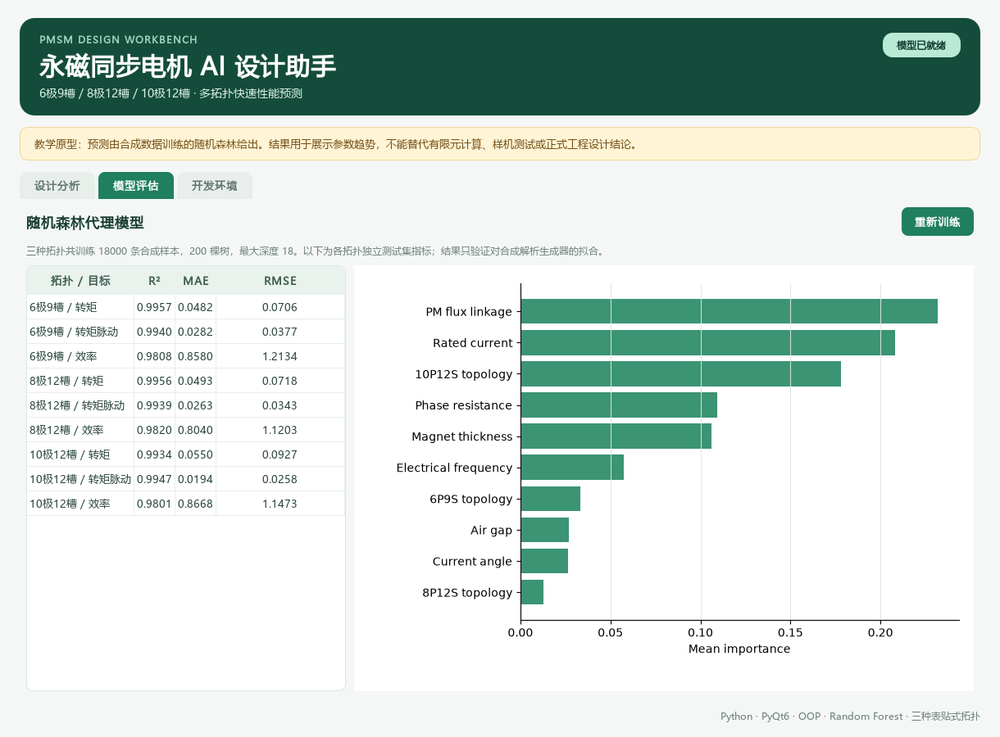

# 永磁同步电机 AI 设计助手

> 当前状态：三种表贴式 PMSM 拓扑的 AI 快速预测原型已实现。

本项目围绕永磁同步电机（PMSM）设计，提供基于 PyQt6 的交互式设计分析工具。客户选择常用表贴式槽极组合，填写基础电机参数，即可通过统一随机森林模型预测平均转矩、转矩脉动和效率。


[查看高级参数页](docs/images/advanced-parameters.png)

## 已实现

- 表贴式 6 极 9 槽、8 极 12 槽和 10 极 12 槽三种拓扑。
- 按客户习惯拆分的“基础参数 / 高级参数”两级输入界面。
- 11 个带单位和范围校验的设计参数，拓扑作为模型分类特征。
- 降阶等效磁路、dq 转矩、损耗和拓扑相关脉动估计。
- 三种拓扑各 6000 条、总计 18000 条物理约束合成数据。
- 三个独立随机森林目标模型、分层数据划分、模型持久化和分拓扑误差报告。
- GUI 单次预测、解析基准对照、参数扫描、测试指标和特征重要性。
- 模型缺失时的一键后台训练，以及模型/数据损坏时的可恢复错误提示。
- GUI、环境检查、后台训练和算法模块的自动化测试。

## 快速开始

```powershell
cd D:\CODES\pmsm-ai-design-assistant
conda activate pmsm-ai
python -m pip install -e .
python -m pmsm_ai
```

仓库不提交约 61 MB 的模型二进制文件。首次使用时可点击界面中的“一键训练模型”，从已提交的 CSV 重新训练。也可以提前运行：

```powershell
python scripts/generate_dataset.py
python scripts/train_surrogate.py
python -m pmsm_ai
```

`scripts/generate_dataset.py` 使用固定种子 42，正常情况下会生成与提交文件一致的数据。

## 验证

```powershell
python scripts/check_environment.py
python -m pytest -q
python -m ruff check .
python scripts/render_preview.py
```

GUI 测试固定使用 `QT_QPA_PLATFORM=offscreen`，不要求桌面显示服务。

## 模型摘要

综合独立测试集上三个随机森林模型的 R² 分别约为：

- 平均转矩：0.995
- 转矩脉动：0.997
- 效率：0.981

三种拓扑的独立测试集指标均保持在 R² 约 0.98–0.996。这些指标只说明模型能够拟合合成解析生成器，不能解释为真实 PMSM 的预测精度。详细公式、参数范围、分拓扑指标和限制见[数据与模型卡](docs/07-model-card.md)。



## 工程结构

- `src/pmsm_ai/domain.py`：三种拓扑、设计参数、校验和结果类型。
- `src/pmsm_ai/analytical.py`：降阶解析模型与物理派生特征。
- `src/pmsm_ai/dataset.py`：拉丁超立方采样与数据生成。
- `src/pmsm_ai/surrogate.py`：随机森林训练、评价和持久化。
- `src/pmsm_ai/service.py`：预测、适用范围检查和参数扫描。
- `src/pmsm_ai/ui/`：PyQt6 工作台、指标卡和 Matplotlib 图表。
- `data/`：可复现 CSV 与元数据。

## 文档

- [课程要求映射](docs/01-course-requirements.md)
- [项目说明](docs/02-project-brief.md)
- [技术可行性](docs/03-technical-feasibility.md)
- [风险清单](docs/04-risk-register.md)
- [大模型协作记录](docs/05-ai-collaboration-log.md)
- [环境报告](docs/06-environment-report.md)
- [数据与模型卡](docs/07-model-card.md)
- [参考资料](docs/references.md)

## 使用边界

- 这是课程学习与科研准备项目，不是经过认证的电机设计软件。
- 转矩脉动来自带拓扑修正的经验化教学公式，不是严格齿槽转矩有限元结果。
- 合成数据不能作为有限元或实验精度的证据。
- 随机森林不能外推到训练参数和功率覆盖范围之外。
- 正式报告必须披露数据来源、模型假设、参数范围、评价指标和误差。
